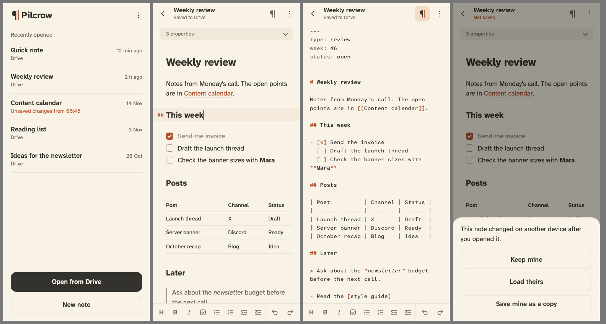
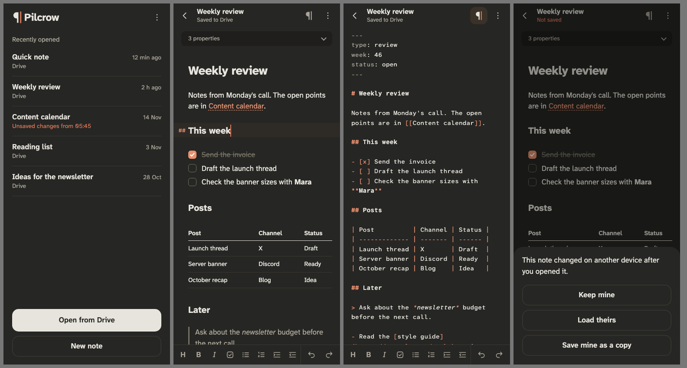

<p align="center">
  
</p>

<h1 align="center">Pilcrow</h1>

<p align="center">
  A Markdown editor for Android that edits your notes where they already live:<br>
  Google Drive, or any other storage the Android file picker can reach.
</p>



## Why

Most Markdown apps on Android want your notes inside their own folder or their own sync
service. Pilcrow has neither. You pick a file, or tap "Open with" in the Drive app, and you
edit that file. Saving writes back to the same file. There is no copy, no import and no export.

## What it does

- **Opens notes in place.** Through the Android file picker, or "Open with" from Drive and
  from file managers. Recently opened notes are listed on the home screen.
- **Two views of one file.** *Formatted* is editable and hides the Markdown marks until the
  cursor is on them. *Source* shows the raw text. The ¶ button switches between them.
- **Understands the Markdown people write in Obsidian.** Headings, lists, task lists,
  tables, quotes, code, links, `[[wikilinks]]` and YAML properties.
- **Leaves the rest of your file alone.** The Markdown you wrote is the file. Pilcrow never
  reformats it, and it keeps the line endings and the byte-order mark the file came with.
  A file that mixes two kinds of line endings is saved with one, and the app tells you.
- **Works hard not to lose text.** Every change goes to a local draft at once and is saved
  to the file two seconds later. Each save is read back to check it arrived. If the file
  changed on another device while you had it open, Pilcrow asks before it writes anything.
- **Stays on the phone.** The app has no internet permission, no account, no analytics and
  no ads. Your storage provider does the syncing, as it already does.



## Status

Pilcrow is at **0.1.0**, its first public version, and it is young. The editor and the
save logic are covered by 163 automated tests, and the release build was run on an Android 16
emulator: it opened a local note, saved typed text and a ticked checkbox back to the file, and
switched views. Testing on real phones against Google Drive has only just started.

Until it has more hours behind it, try it on notes you have a backup of, and please
[open an issue](../../issues) when something goes wrong.

Known limits in this version:

- Files over 5 MB, and files that are not UTF-8, open read-only.
- Tables and properties are shown formatted and are edited as text when you tap them.
- Images are not shown.
- There is no folder browser and no search across notes: Android does not give apps a
  folder view of Drive.

## Install

Download `pilcrow-0.1.0.apk` from the [latest release](../../releases/latest) and open it on
the phone. Android asks once for permission to install from that source. Pilcrow needs
Android 10 or newer.

## Build it yourself

You need JDK 21, Node.js 24 and the Android SDK with platform 37.

```bash
git clone https://github.com/kleokl7/pilcrow.git
cd pilcrow
echo "sdk.dir=/path/to/your/android/sdk" > local.properties
(cd editor && npm ci)
./gradlew :app:assembleDebug        # app/build/outputs/apk/debug/
```

Run the tests:

```bash
(cd editor && npm test && npm run typecheck)   # the editor
./gradlew :app:testDebugUnitTest               # file handling and saving
```

`scripts/install.sh` builds the app and installs it on a phone connected with adb.
`scripts/smoke.sh` installs the release build on a phone or an emulator and checks that the
app starts and its editor page loads.

## How it is built

Pilcrow is one Android activity that hosts a WebView.

- [`editor/`](editor) is the interface, written in TypeScript on
  [CodeMirror 6](https://codemirror.net/). The Markdown source is always the document. The
  formatted view is a layer of decorations over that source, which is why switching views
  can never change the file.
- [`app/`](app) is Kotlin. It owns everything that touches a file: reading and writing
  through the Storage Access Framework, text encoding, drafts, autosave, the read-back
  check, the conflict guard and the list of recent notes.
- The two sides talk through a small JSON bridge. The editor is loaded from the app's own
  assets and has no network access.
- [`design/`](design) holds the logo and the mockups the interface was built from.

## Credits

Pilcrow stands on [CodeMirror](https://codemirror.net/) and
[Lezer](https://lezer.codemirror.net/) by Marijn Haverbeke and contributors, and is set in
[Atkinson Hyperlegible Next](https://www.brailleinstitute.org/freefont/) from the Braille
Institute. See [THIRD_PARTY_NOTICES.md](THIRD_PARTY_NOTICES.md).

Pilcrow is an independent project. It is not affiliated with Obsidian or Google.

## License

[MIT](LICENSE)
